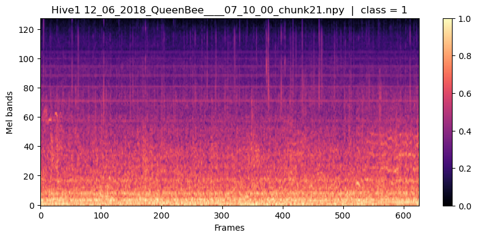
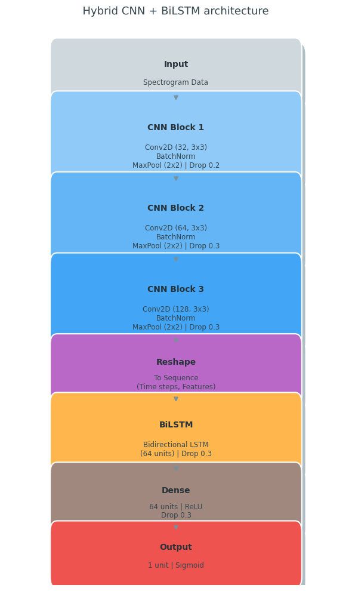
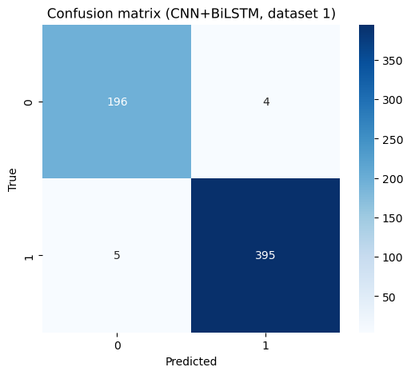
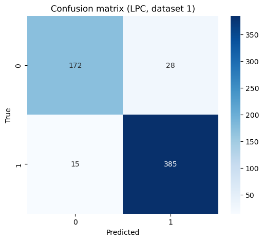
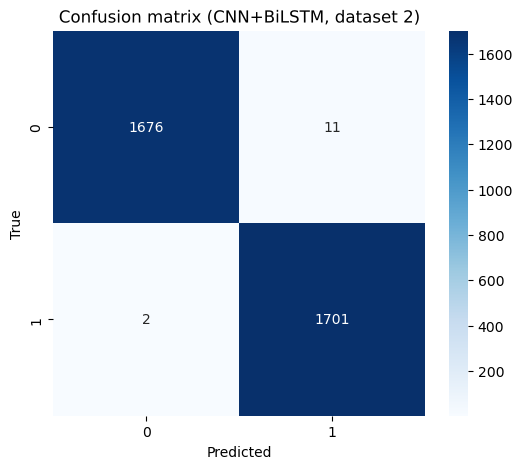
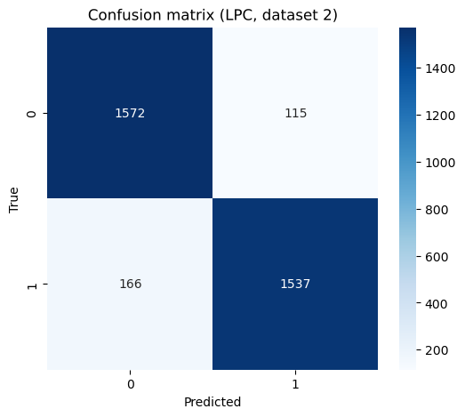

# Queen bee detection from hive sound (CNN + BiLSTM)

Code from my engineering thesis in Bioinformatics (Wrocław University of Environmental and Life Sciences, 2026): *Application of machine learning models for detecting the presence of a queen bee based on hive sound analysis*.

The goal is a non-invasive way to tell whether a colony has lost its queen, using only recordings from inside the hive. I compared a classical approach (LPC features and a small MLP) with a deep model that works on mel-spectrograms (CNN followed by a bidirectional LSTM).

   
  Mel-spectrogram of a 10-second hive recording (queen present). This is the input of the deep model.

## Data

The data is **not included** here. Both datasets come from the NU-Hive project and are described in the references below.

- **Dataset 1:** a subset available on [Kaggle](https://www.kaggle.com/datasets/harshkumar1711/beehive-audio-dataset-with-queen-and-without-queen) with 6000 short recordings from one hive (4000 with a queen, 2000 without). I used it to check how the models behave on imbalanced data and whether they pick up environmental artifacts of a given recording day.
- **Dataset 2:** the full NU-Hive dataset from [Zenodo](https://zenodo.org/records/1321278): 576 ten-minute recordings (about 96 hours) from two hives, labelled with the `state_labels.csv` file that comes with the dataset. After cutting it into short samples I got 33,891 of them.

Paths in the notebooks are placeholders. To run the code you need to download the data and point the notebooks to your own folders.

## Method

- **Spectrograms:** 10-second clips at 32 kHz, 128 mel bands, converted to dB and scaled to 0–1.
- **CRNN:** three convolution blocks (32, 64 and 128 filters, with batch normalisation, max pooling and dropout), then a bidirectional LSTM with 64 units, a dense layer and a sigmoid output. Adam with learning rate 1e-4, binary cross-entropy, early stopping with patience 10.
- **Baseline:** 16th-order LPC coefficients fed to an MLP with two hidden layers.
- **Split:** 80% train, 10% validation, 10% test. Both models get exactly the same files in each part. The notebooks check that no file appears in both train and test.

   
  Architecture of the CRNN model.

## Results (test set)

| Dataset | Test samples | CRNN accuracy | LPC + MLP accuracy |
| --- | --- | --- | --- |
| 1: one hive | 600 | 98.5% | 92.8% |
| 2: two hives | 3390 | 99.6% | 91.7% |

On dataset 1 the area under the ROC curve was 0.999 for the CRNN and 0.969 for the baseline. The CRNN also handled the more varied second dataset better, while the LPC model got worse.

<table>
  <tr>
    <td align="center"> Dataset 1, CRNN</td>
    <td align="center"> Dataset 1, LPC + MLP</td>
  </tr>
  <tr>
    <td align="center"> Dataset 2, CRNN</td>
    <td align="center"> Dataset 2, LPC + MLP</td>
  </tr>
</table>

## Limitations

- The split is random over samples, so short clips cut from the same recording can end up in train, validation and test at the same time. Such clips sound very similar, so the model may partly learn to recognise a recording instead of the presence of a queen. The notebooks only check that no file name appears in more than one set. The numbers show how well the model separates the two states **within these hives**, and they are probably optimistic. A split by whole recordings, or by hive, would be a fairer test.
- The results come from a single training run, and the random seed of TensorFlow is not set, so running the notebooks again gives slightly different numbers.
- I did not test the models on hives they had never seen, because there are few public datasets of this kind. This is the most important next step before claiming the method works in general.
- A missing queen is only one of the things that change the sound of a hive (parasites, disease, pesticides), and the models were not tested against them.

## Repository

- `notebooks/01_dataset1_single_hive.ipynb` – dataset 1: spectrograms, CRNN, LPC baseline, ROC curves, error analysis
- `notebooks/02_dataset2_two_hives.ipynb` – the same pipeline on the full dataset 2
- `images/` – figures used in this README, taken from the notebooks

Tools: Python 3.11, TensorFlow and Keras, librosa, scikit-learn, pandas, NumPy, matplotlib, seaborn.

## References

- Harsh Kumar, [*BeeHive Audio Dataset with Queen and without Queen*](https://www.kaggle.com/datasets/harshkumar1711/beehive-audio-dataset-with-queen-and-without-queen) (Kaggle).
- Nolasco I., Terenzi A., Cecchi S., Orcioni S., Bear H. L., Benetos E. (2019). *Audio-based identification of beehive states*. ICASSP 2019.
- Nolasco I., Terenzi A., Cecchi S., Orcioni S., Bear H. L., Benetos E. (2019). [*Audio-based identification of beehive states: the dataset*](https://zenodo.org/records/1321278) (Zenodo).

## Author

Wiktoria Kowalska – [GitHub](https://github.com/RelVexai) · [LinkedIn](https://www.linkedin.com/in/wiktoria-kowalska-1984693b1/)
